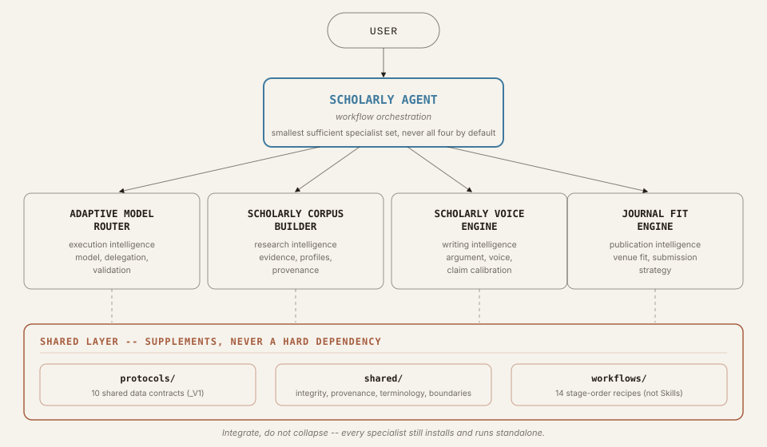

# Scholarly Agent Suite

**English** · [繁體中文](README.zh-TW.md)

An evidence-first AI research assistant for academic work in any discipline.
It helps you go from an idea, a pile of notes, or a draft manuscript to a
well-argued paper and a defensible submission plan, while keeping every
citation, metric, and claim traceable to a real source.

The Suite is one installable package made of five cooperating Agent Skills:
a small orchestrator that plans the work, and four specialists that each own
one part of the scholarly process.

> **What it is not.** It is not a one-click paper generator, it does not
> predict acceptance, and it never invents citations, DOIs, quotations,
> journal metrics, or corpus statistics. See [Integrity
> guarantees](#integrity-guarantees).

## What you can ask it

Ask in plain language. The orchestrator picks the matching workflow recipe
and calls only the specialists that recipe actually needs.

| You want to... | Workflow recipe | Specialists involved |
|---|---|---|
| Turn a research idea into a manuscript | [paper-from-idea](skills/scholarly-agent/references/workflows/paper-from-idea.md) | (Corpus), Voice, (Journal Fit) |
| Turn notes or fragments into a paper | [paper-from-notes](skills/scholarly-agent/references/workflows/paper-from-notes.md) | (Corpus), Voice, (Journal Fit) |
| Write an empirical paper (IMRaD and variants) | [empirical-paper](skills/scholarly-agent/references/workflows/empirical-paper.md) | Corpus, Voice |
| Write a theoretical or conceptual paper | [theory-paper](skills/scholarly-agent/references/workflows/theory-paper.md) | Corpus, Voice |
| Revise a manuscript, including reviewer responses | [revise-manuscript](skills/scholarly-agent/references/workflows/revise-manuscript.md) | Voice, (Corpus), (Journal Fit) |
| Write a narrative literature review | [literature-review](skills/scholarly-agent/references/workflows/literature-review.md) | Corpus, Voice |
| Run a systematic review (PRISMA-style) | [systematic-review](skills/scholarly-agent/references/workflows/systematic-review.md) | Corpus, Voice |
| Write a short commentary or perspective piece | [nature-commentary](skills/scholarly-agent/references/workflows/nature-commentary.md) | Corpus, Voice |
| Plan and draft a whole book | [book-project](skills/scholarly-agent/references/workflows/book-project.md) | Corpus, Voice |
| Write one monograph chapter | [monograph-chapter](skills/scholarly-agent/references/workflows/monograph-chapter.md) | (Corpus), Voice |
| Find suitable journals for a manuscript | [journal-selection](skills/scholarly-agent/references/workflows/journal-selection.md) | Journal Fit, Corpus |
| Adapt a manuscript to a chosen journal | [target-journal-adaptation](skills/scholarly-agent/references/workflows/target-journal-adaptation.md) | Journal Fit, Voice, (Corpus) |
| Learn your own writing voice from past papers | [author-voice-calibration](skills/scholarly-agent/references/workflows/author-voice-calibration.md) | Corpus, Voice |
| Build a discipline, journal, or historical style profile | [corpus-profile-build](skills/scholarly-agent/references/workflows/corpus-profile-build.md) | Corpus |

Specialists in parentheses join only when the request calls for them, and
the Adaptive Model Router can sit under any recipe as an optional execution
layer. The
exact routing rules live in
[`routing-matrix.md`](skills/scholarly-agent/references/routing-matrix.md).
A small single-step task, such as polishing one paragraph, skips the
orchestrator and goes straight to the one specialist that owns it.

Example prompts:

- "Help me turn this research idea into a manuscript and find a journal."
- "Revise this draft for *Journal X* and draft a response to reviewers."
- "Build a style profile from my last ten articles, then rewrite this
  introduction in my own voice."
- "Which open-access journals in education policy fit this paper, with no
  APC above 2,000 USD?"

## The five Skills

| Skill | Owns | What it does |
|---|---|---|
| [scholarly-agent](skills/scholarly-agent/SKILL.md) | Orchestration | Breaks a multi-stage task into steps, picks a workflow recipe, hands data between specialists, and runs a final integrity and completeness check. |
| [adaptive-model-router](skills/adaptive-model-router/SKILL.md) | Execution | Decides how a task is executed: model tier, when to delegate to subagents, and when escalation is justified. |
| [scholarly-corpus-builder](skills/scholarly-corpus-builder/SKILL.md) | Research evidence | Retrieves open scholarly literature (OpenAlex, Crossref, PubMed/PMC, arXiv, DOAJ, your own files) with provenance, and builds discipline, journal, historical, and author-voice style profiles. |
| [scholarly-voice-engine](skills/scholarly-voice-engine/SKILL.md) | Writing and argument | Writes and edits discipline-aware, genre-aware academic prose, calibrates claims, checks citation integrity, and keeps long projects consistent. |
| [journal-fit-engine](skills/journal-fit-engine/SKILL.md) | Publication strategy | Profiles the manuscript, generates candidate journals, applies hard filters (scope, APC, open access, indexing), scores fit with evidence, and produces a submission strategy. |

Each Skill keeps its own trigger boundary, references, tests, and version,
and still works on its own if installed separately. Exact bundled versions
and source commits are recorded in [`COMPONENTS.json`](COMPONENTS.json),
which is the single source of truth.

## How it works



```
User
 |
 v
Scholarly Agent (orchestration)
 |
 +-- Adaptive Model Router      (execution)
 +-- Scholarly Corpus Builder   (research evidence)
 +-- Scholarly Voice Engine     (writing and argument)
 +-- Journal Fit Engine         (publication strategy)

Shared layer:
 protocols/   versioned JSON data contracts between Skills
 shared/      integrity, provenance, terminology, capability boundaries
```

The orchestrator is not a fixed pipeline. For every request it checks
whether two or more specialists are genuinely needed, reuses fresh results
from earlier steps, carries hard constraints (APC limits, word counts,
open-access requirements) forward, allows one bounded repair pass, and ends
in one of three honest states: `COMPLETE`, `COMPLETE_WITH_LIMITATIONS`, or
`BLOCKED`.


Specialists hand work to each other through ten versioned JSON Schemas in
[`protocols/`](protocols/): `EXECUTION_POLICY_V1`, `SCHOLARLY_PROFILE_V1`,
`VOICE_REQUEST_V1`, `VOICE_CONTEXT_V1`, `VOICE_OUTPUT_V1`,
`MANUSCRIPT_PROFILE_V1`, `TARGET_JOURNAL_PROFILE_V1`,
`JOURNAL_STYLE_CONTEXT_V1`, `CONTINUITY_STATE_V1`, and
`PROVENANCE_RECORD_V1`. For example, Journal Fit Engine produces a
`JOURNAL_STYLE_CONTEXT_V1` that Voice Engine consumes, so a journal's
official requirements and its merely observed house style never get mixed
up.

## Install

**Option A: the whole Suite (recommended).** Install the repository as a
plugin through [`.codex-plugin/plugin.json`](.codex-plugin/plugin.json), or
unzip a release package (`scholarly-agent-suite-v<version>.zip`). All five
Skills, the workflow recipes, the protocols, and the shared policies become
available together.

**Option B: one Skill on its own.** Copy any folder under `skills/` into
your host's skills directory, or install it from its own repository. Every
Skill is self-contained: none of them needs `shared/` or `protocols/` next
to it to run.

To check a local checkout:

```bash
pip install pytest jsonschema
python scripts/validate_suite.py   # acceptance checks
pytest tests/                      # suite tests
```

## Integrity guarantees

These rules apply to every bundled Skill and are enforced by the
orchestrator's final quality gate
([`shared/integrity-policy.md`](shared/integrity-policy.md)):

- No fabricated citations, DOIs, quotations, journal metrics, corpus
  counts, or acceptance probabilities. Anything unverified is labelled as
  such.
- No paywall bypassing or shadow libraries; only open or user-supplied
  sources.
- No imitation of a living author's voice; author-voice calibration is for
  your own writing.
- No AI-detector evasion as a goal.
- A specialist's unresolved integrity flag is never silently dropped on the
  way to a "complete" result.

## Repository layout

```
skills/            the five Skills (four synced from their own repos, one in-tree)
protocols/         JSON Schemas for the shared data contracts
shared/            cross-Skill policies and terminology
workflows/         generated read-only mirror of the orchestrator's recipes
assets/            README diagrams (not shipped in the runtime package)
scripts/           sync, drift check, validation, and packaging tools
tests/, evals/     suite tests and orchestration fixtures
docs/              maintainer documentation
```

## Development and releases

The four specialist Skills are developed in their own repositories and
pinned here by exact commit; the orchestrator lives in this repository.
Syncing, component drift detection, packaging, test coverage, versioning
rules, and known limitations are documented in
[`docs/development.md`](docs/development.md). The release procedure is in
[`RELEASE_CHECKLIST.md`](RELEASE_CHECKLIST.md) and the history in
[`CHANGELOG.md`](CHANGELOG.md).

## Roadmap

New specialists (for example a peer-review, systematic-review, or
grant-writing engine) are added only when each has a distinct trigger
boundary, substantial policy of its own, and standalone usefulness, not
merely because a feature could be split out.

## License

[MIT](LICENSE)
