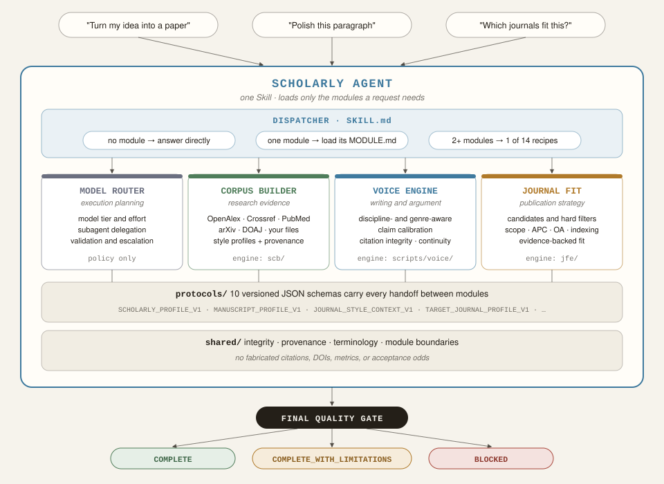
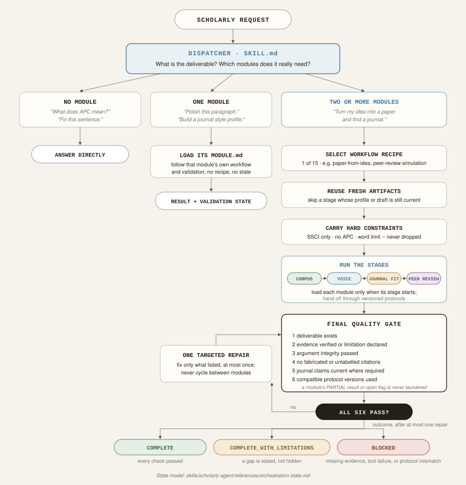

# Scholarly Agent 學術智能體

[English](README.md) · **繁體中文**

一套以證據為先、適用於各學科的學術研究 AI 助理。它協助你從一個研究構想、一堆筆記或一份初稿出發，完成論證扎實的論文與站得住腳的投稿策略，同時讓每一筆引用、指標與主張都能追溯到真實來源。

它是單一個 Agent Skill：`scholarly-agent`，內建五個模組：執行規劃、研究證據、學術寫作、投稿策略與模擬審稿。調度器會讀懂每個需求，只載入該需求用得到的模組，所以潤飾一段文字依然很快，而從構想到投稿的完整專案則會走完整條流程。



> **它不是什麼。** 它不是一鍵生成論文的工具，不預測錄用機率，也絕不捏造引用、DOI、引文、期刊指標或語料統計數字。詳見〈[學術誠信保證](#學術誠信保證)〉。

## 你可以請它做什麼

直接用自然語言提出需求即可。調度器會挑選對應的工作流程，並只載入該流程真正用到的模組（語料＝語料建構模組，寫作＝寫作引擎）。

| 你想要…… | 工作流程 | 使用的模組 |
|---|---|---|
| 把研究構想發展成論文 | [paper-from-idea](skills/scholarly-agent/references/workflows/paper-from-idea.md) | （語料）、寫作、（期刊匹配） |
| 把筆記或零散素材整理成論文 | [paper-from-notes](skills/scholarly-agent/references/workflows/paper-from-notes.md) | （語料）、寫作、（期刊匹配） |
| 撰寫實證論文（IMRaD 及其變體） | [empirical-paper](skills/scholarly-agent/references/workflows/empirical-paper.md) | 語料、寫作 |
| 撰寫理論或概念型論文 | [theory-paper](skills/scholarly-agent/references/workflows/theory-paper.md) | 語料、寫作 |
| 修改稿件，含回覆審稿意見 | [revise-manuscript](skills/scholarly-agent/references/workflows/revise-manuscript.md) | 寫作、（語料）、（期刊匹配） |
| 撰寫敘述型文獻回顧 | [literature-review](skills/scholarly-agent/references/workflows/literature-review.md) | 語料、寫作 |
| 進行系統性回顧（PRISMA 式） | [systematic-review](skills/scholarly-agent/references/workflows/systematic-review.md) | 語料、寫作 |
| 撰寫短評或觀點文章 | [nature-commentary](skills/scholarly-agent/references/workflows/nature-commentary.md) | 語料、寫作 |
| 規劃並撰寫整本專書 | [book-project](skills/scholarly-agent/references/workflows/book-project.md) | 語料、寫作 |
| 撰寫專著的單一章節 | [monograph-chapter](skills/scholarly-agent/references/workflows/monograph-chapter.md) | （語料）、寫作 |
| 為稿件尋找合適期刊 | [journal-selection](skills/scholarly-agent/references/workflows/journal-selection.md) | 期刊匹配、語料 |
| 依選定期刊調整稿件 | [target-journal-adaptation](skills/scholarly-agent/references/workflows/target-journal-adaptation.md) | 期刊匹配、寫作、（語料） |
| 從自己過去的論文學習個人寫作風格 | [author-voice-calibration](skills/scholarly-agent/references/workflows/author-voice-calibration.md) | 語料、寫作 |
| 建立學科、期刊或歷史學者的風格檔案 | [corpus-profile-build](skills/scholarly-agent/references/workflows/corpus-profile-build.md) | 語料 |
| 投稿前模擬審稿與編輯決定，再修改稿件並回覆審稿人 | [peer-review-simulation](skills/scholarly-agent/references/workflows/peer-review-simulation.md) | 審稿、（寫作）、（期刊匹配）、（語料） |

括號中的模組只在需求確實需要時才加入；模型路由模組可作為任何流程底下的選用執行層。完整的路由規則見 [`routing-matrix.md`](skills/scholarly-agent/references/routing-matrix.md)。單一步驟的小任務（例如潤飾一段文字）不需要工作流程，只會載入負責的那一個模組。

範例提問：

- 「幫我把這個研究構想寫成論文，並推薦適合投稿的期刊。」
- 「依《某期刊》的要求修改這份稿件，並草擬審稿意見回覆。」
- 「用我最近十篇文章建立寫作風格檔案，再用我自己的風格改寫這段引言。」
- 「教育政策領域有哪些開放取用期刊適合這篇論文？APC 不超過 2,000 美元。」
- 「請用《某期刊》三位審稿人的角度審這篇論文，並告訴我編輯會怎麼決定。」
- 「這是我的 Zotero 匯出檔，請用它當文獻回顧的起始語料。」

## 五個模組

| 模組 | 負責範圍 | 功能 |
|---|---|---|
| [模型路由 Model Router](skills/scholarly-agent/modules/adaptive-model-router/MODULE.md) | 執行規劃 | 決定大型任務如何執行：模型層級、推理強度、何時委派子代理、何時才值得升級。角色可對應到 OpenAI/Codex、Claude、Gemini 或本機模型。只在平台確實能派發任務時使用。 |
| [語料建構 Corpus Builder](skills/scholarly-agent/modules/scholarly-corpus-builder/MODULE.md) | 研究證據 | 從開放學術來源（OpenAlex、Crossref、PubMed/PMC、arXiv、DOAJ 及你自己的檔案）檢索文獻並保留出處，可匯入與匯出 Zotero、Mendeley、EndNote 等文獻管理工具的資料（BibTeX、RIS、CSL-JSON），並建立學科、期刊、歷史學者與作者風格檔案。 |
| [寫作引擎 Voice Engine](skills/scholarly-agent/modules/scholarly-voice-engine/MODULE.md) | 寫作與論證 | 依學科與文類撰寫、編修學術文字，校準主張強度，檢查引用誠信，並維持專書等長篇專案的一致性。 |
| [期刊匹配 Journal Fit](skills/scholarly-agent/modules/journal-fit-engine/MODULE.md) | 投稿策略 | 分析稿件特徵、產生候選期刊、套用硬性篩選（範圍、APC、開放取用、收錄資料庫）、以證據評估匹配度，並提出投稿策略。可讀取開放的 [POSI](https://github.com/WENSHAO521/posi-data) 期刊資料（約 15.8 萬種期刊的引用排名），作為另一個明確標示來源的證據。 |
| [同儕審稿 Peer Review](skills/scholarly-agent/modules/peer-review-engine/MODULE.md) | 模擬審稿 | 由編輯先做初審（desk screen），再挑 2 到 3 位不同角度的審稿人（方法、理論、文獻等）；平台能派發時，每位審稿人都是獨立的子代理，互相看不到彼此的意見。編輯依據「成立的問題」而不是投票數做出決定，列出編號的必改事項，之後還能檢查一次你的修改稿與回覆信。一律標明是模擬，絕不預測真實期刊的決定。 |

調度器本身寫在 [`SKILL.md`](skills/scholarly-agent/SKILL.md)。即使合併成一個 Skill，各模組的職責仍然分開：語料模組不推薦期刊、寫作模組不挑選模型，依此類推（見 [`capability-boundaries.md`](skills/scholarly-agent/shared/capability-boundaries.md)）。語料建構、寫作引擎、期刊匹配與同儕審稿還附有經過測試的 Python 引擎（`scb/`、`scripts/voice/`、`jfe/`、`prv/`），負責流程中機械性的部分。

## 運作方式

每收到一個需求，調度器會在三條路徑中擇一：簡單問題直接回答、載入單一模組，或執行跨模組的工作流程。在工作流程中，它會重用先前步驟仍然新鮮的結果，把硬性限制（APC 上限、字數、開放取用要求）一路帶下去，允許一次有上限的修正，最後誠實地以三種狀態之一結束：`COMPLETE`、`COMPLETE_WITH_LIMITATIONS` 或 `BLOCKED`。



模組之間透過 [`protocols/`](skills/scholarly-agent/protocols/) 中十二份有版本的 JSON Schema 交接工作，其中 `REVIEW_REPORT_V1` 與 `EDITORIAL_DECISION_V1` 負責審稿報告與編輯決定。例如期刊匹配模組產出 `JOURNAL_STYLE_CONTEXT_V1` 給寫作引擎使用，確保期刊的「官方要求」與「僅觀察到的慣用風格」不會混為一談。

## 安裝

**以外掛安裝。** 透過 [`.codex-plugin/plugin.json`](.codex-plugin/plugin.json) 安裝本倉庫，或解壓縮發行包（`scholarly-agent-suite-v<版本>.zip`）。

**以一般 Skill 安裝。** 把 `skills/scholarly-agent/` 複製到你的 skills 目錄即可。它是自足的：模組、協定、共用政策與工作流程都在這一個資料夾裡。

在本機檢查：

```bash
pip install pytest jsonschema
python scripts/validate_suite.py   # 驗收檢查
pytest tests/                      # 測試
```

## 學術誠信保證

以下規則適用於所有模組，並由最終品質關卡把關（[`integrity-policy.md`](skills/scholarly-agent/shared/integrity-policy.md)）：

- 不捏造引用、DOI、引文、期刊指標、語料數量或錄用機率；未經驗證的內容一律明確標示。
- 不繞過付費牆、不使用影子圖書館；只使用開放來源或使用者提供的資料。
- 不模仿在世作者的文風；作者風格校準只用於你自己的寫作。
- 不以規避 AI 偵測為目標。
- 模組提出且尚未解決的誠信警示，絕不會在產出「完成」結果的過程中被悄悄略過。

## 開發與發行

包括五個模組在內，所有內容都在本倉庫中開發。v1.2.1 以前這些模組是各自獨立、從自己倉庫同步進來的 Skill；v2.0.0 將它們合併（見 [`CHANGELOG.md`](CHANGELOG.md)）。目錄規則、版本、測試、打包與已知限制請見 [`docs/development.md`](docs/development.md)（英文），發行為全自動：把新的 `VERSION` 合併進 `master`，就會自動打包並發佈成 GitHub release（見 [`RELEASE_CHECKLIST.md`](RELEASE_CHECKLIST.md)）。

## 授權

[MIT](LICENSE)
