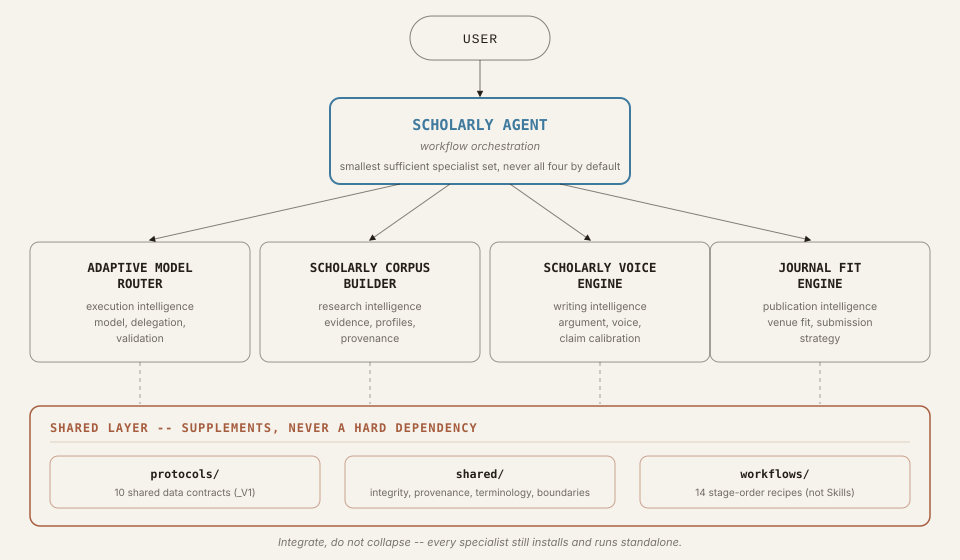

# Scholarly Agent Suite 學術智能體套件

[English](README.md) · **繁體中文**

一套以證據為先、適用於各學科的學術研究 AI 助理。它協助你從一個研究構想、一堆筆記或一份初稿出發，完成論證扎實的論文與站得住腳的投稿策略，同時讓每一筆引用、指標與主張都能追溯到真實來源。

整個套件是一個可一次安裝的套件包，由五個彼此協作的 Agent Skill 組成：一個負責規劃工作的輕量協調者，以及四個各自負責學術流程中一個環節的專家。

> **它不是什麼。** 它不是一鍵生成論文的工具，不預測錄用機率，也絕不捏造引用、DOI、引文、期刊指標或語料統計數字。詳見〈[學術誠信保證](#學術誠信保證)〉。

## 你可以請它做什麼

直接用自然語言提出需求即可。協調者會挑選對應的工作流程，並只呼叫該流程真正需要的專家。

| 你想要…… | 工作流程 | 參與的專家 |
|---|---|---|
| 把研究構想發展成論文 | [paper-from-idea](skills/scholarly-agent/references/workflows/paper-from-idea.md) | （語料）、寫作、（期刊匹配） |
| 把筆記或零散素材整理成論文 | [paper-from-notes](skills/scholarly-agent/references/workflows/paper-from-notes.md) | （語料）、寫作、（期刊匹配） |
| 撰寫實證論文（IMRaD 及其變體） | [empirical-paper](skills/scholarly-agent/references/workflows/empirical-paper.md) | 語料、寫作 |
| 撰寫理論或概念型論文 | [theory-paper](skills/scholarly-agent/references/workflows/theory-paper.md) | 語料、寫作 |
| 修改稿件，含回覆審稿意見 | [revise-manuscript](skills/scholarly-agent/references/workflows/revise-manuscript.md) | 寫作、（語料）、（期刊匹配） |
| 撰寫敘述型文獻回顧 | [literature-review](skills/scholarly-agent/references/workflows/literature-review.md) | 語料、寫作 |
| 進行系統性回顧（PRISMA 式） | [systematic-review](skills/scholarly-agent/references/workflows/systematic-review.md) | 語料、寫作 |
| 撰寫短評或觀點文章 | [nature-commentary](skills/scholarly-agent/references/workflows/nature-commentary.md) | 語料、寫作 |
| 規劃並撰寫整本專書 | [book-project](skills/scholarly-agent/references/workflows/book-project.md) | 語料、寫作 |
| 撰寫專著的單一章節 | [monograph-chapter](skills/scholarly-agent/references/workflows/monograph-chapter.md) | （語料）、寫作 |
| 為稿件尋找合適期刊 | [journal-selection](skills/scholarly-agent/references/workflows/journal-selection.md) | 期刊匹配、語料 |
| 依選定期刊調整稿件 | [target-journal-adaptation](skills/scholarly-agent/references/workflows/target-journal-adaptation.md) | 期刊匹配、寫作、（語料） |
| 從自己過去的論文學習個人寫作風格 | [author-voice-calibration](skills/scholarly-agent/references/workflows/author-voice-calibration.md) | 語料、寫作 |
| 建立學科、期刊或歷史學者的風格檔案 | [corpus-profile-build](skills/scholarly-agent/references/workflows/corpus-profile-build.md) | 語料 |

括號中的專家只在需求確實需要時才加入；自適應模型路由器可作為任何流程底下的選用執行層。完整的路由規則見 [`routing-matrix.md`](skills/scholarly-agent/references/routing-matrix.md)。單一步驟的小任務（例如潤飾一段文字）會跳過協調者，直接交給負責的那位專家。

範例提問：

- 「幫我把這個研究構想寫成論文，並推薦適合投稿的期刊。」
- 「依《某期刊》的要求修改這份稿件，並草擬審稿意見回覆。」
- 「用我最近十篇文章建立寫作風格檔案，再用我自己的風格改寫這段引言。」
- 「教育政策領域有哪些開放取用期刊適合這篇論文？APC 不超過 2,000 美元。」

## 五個 Skill

| Skill | 負責範圍 | 功能 |
|---|---|---|
| [scholarly-agent](skills/scholarly-agent/SKILL.md) | 協調 | 拆解多階段任務、選擇工作流程、在專家之間傳遞資料，並在最後執行誠信與完整性檢查。 |
| [adaptive-model-router](skills/adaptive-model-router/SKILL.md) | 執行 | 決定任務如何執行：使用哪個模型層級、何時委派子代理、何時才值得升級。 |
| [scholarly-corpus-builder](skills/scholarly-corpus-builder/SKILL.md) | 研究證據 | 從開放學術來源（OpenAlex、Crossref、PubMed/PMC、arXiv、DOAJ 及你自己的檔案）檢索文獻並保留出處，建立學科、期刊、歷史學者與作者風格檔案。 |
| [scholarly-voice-engine](skills/scholarly-voice-engine/SKILL.md) | 寫作與論證 | 依學科與文類撰寫、編修學術文字，校準主張強度，檢查引用誠信，並維持長篇專案的一致性。 |
| [journal-fit-engine](skills/journal-fit-engine/SKILL.md) | 投稿策略 | 分析稿件特徵、產生候選期刊、套用硬性篩選（範圍、APC、開放取用、收錄資料庫）、以證據評估匹配度，並提出投稿策略。 |

每個 Skill 都保有自己的觸發邊界、參考文件、測試與版本，單獨安裝也能正常運作。實際打包的版本與來源 commit 記錄於 [`COMPONENTS.json`](COMPONENTS.json)，以該檔為準。

## 運作方式



協調者不是固定的流水線。每次收到需求，它都會先判斷是否真的需要兩位以上的專家，重用先前步驟仍然新鮮的結果，把硬性限制（APC 上限、字數、開放取用要求）一路帶下去，允許一次有上限的修正，最後誠實地以三種狀態之一結束：`COMPLETE`、`COMPLETE_WITH_LIMITATIONS` 或 `BLOCKED`。


專家之間透過 [`protocols/`](protocols/) 中十份有版本的 JSON Schema 交接工作。例如期刊匹配引擎產出 `JOURNAL_STYLE_CONTEXT_V1` 給寫作引擎使用，確保期刊的「官方要求」與「僅觀察到的慣用風格」不會混為一談。

## 安裝

**方式 A：安裝完整套件（建議）。** 透過 [`.codex-plugin/plugin.json`](.codex-plugin/plugin.json) 以外掛形式安裝本倉庫，或解壓縮發行包（`scholarly-agent-suite-v<版本>.zip`）。五個 Skill、工作流程、協定與共用政策會一起啟用。

**方式 B：只安裝單一 Skill。** 把 `skills/` 底下任一資料夾複製到你的 skills 目錄，或從該 Skill 自己的倉庫安裝。每個 Skill 都是自足的，不需要旁邊有 `shared/` 或 `protocols/` 才能執行。

在本機檢查：

```bash
pip install pytest jsonschema
python scripts/validate_suite.py   # 驗收檢查
pytest tests/                      # 套件測試
```

## 學術誠信保證

以下規則適用於所有內含的 Skill，並由協調者的最終品質關卡把關（[`shared/integrity-policy.md`](shared/integrity-policy.md)）：

- 不捏造引用、DOI、引文、期刊指標、語料數量或錄用機率；未經驗證的內容一律明確標示。
- 不繞過付費牆、不使用影子圖書館；只使用開放來源或使用者提供的資料。
- 不模仿在世作者的文風；作者風格校準只用於你自己的寫作。
- 不以規避 AI 偵測為目標。
- 專家提出且尚未解決的誠信警示，絕不會在產出「完成」結果的過程中被悄悄略過。

## 開發與發行

四個專家 Skill 在各自的倉庫中開發，並以精確的 commit 釘選到本倉庫；協調者則直接在本倉庫中維護。同步、元件漂移偵測、打包、測試涵蓋、版本規則與已知限制，請見 [`docs/development.md`](docs/development.md)（英文）。發行流程見 [`RELEASE_CHECKLIST.md`](RELEASE_CHECKLIST.md)，變更紀錄見 [`CHANGELOG.md`](CHANGELOG.md)。

## 授權

[MIT](LICENSE)
