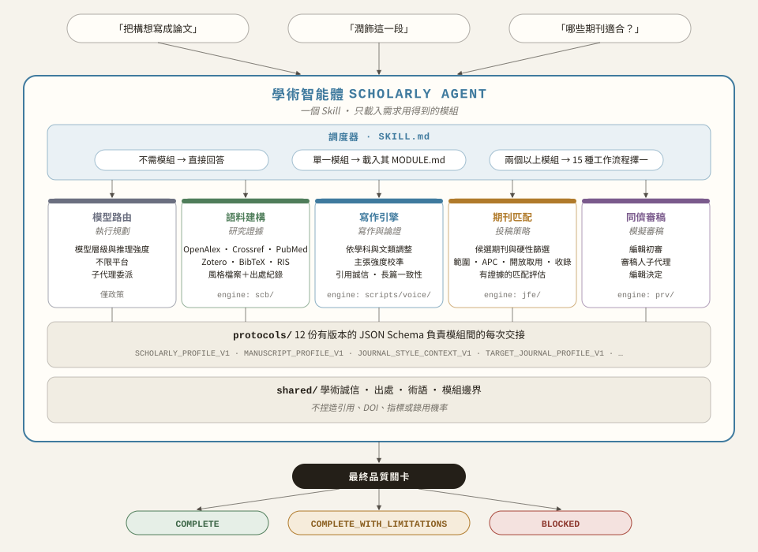
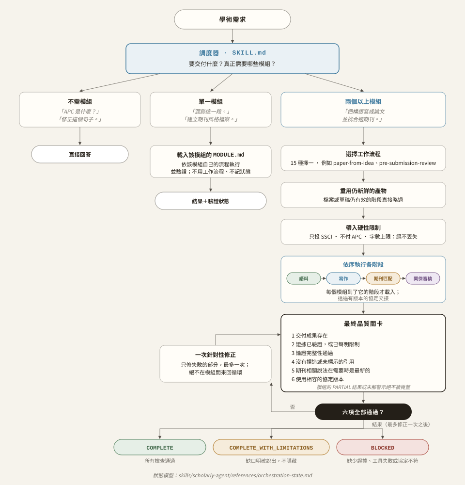

# Scholarly Agent 學術智能體

[English](README.md) · **繁體中文**

一套以證據為先、適用於各學科的學術研究 AI 助理。它協助你從一個研究構想、一堆筆記或一份初稿出發，完成論證扎實的論文與站得住腳的投稿策略，同時讓每一筆引用、指標與主張都能追溯到真實來源。

它是單一個 Agent Skill：`scholarly-agent`，內建七個模組：執行規劃、研究證據、學術寫作、投稿策略、投稿前審稿、適用所有語言的文字潤色，以及任兩種語言之間的學術翻譯。調度器會讀懂每個需求，只載入該需求用得到的模組，所以潤飾一段文字依然很快，而從構想到投稿的完整專案則會走完整條流程。



> **它不是什麼。** 它不是一鍵生成論文的工具，不預測錄用機率，也絕不捏造引用、DOI、引文、期刊指標或語料統計數字。詳見〈[學術誠信保證](#學術誠信保證)〉。

## 你可以請它做什麼

直接用自然語言提出需求即可。調度器會挑選對應的工作流程，並只載入該流程真正用到的模組（語料＝語料建構模組，寫作＝寫作引擎）。

| 你想要…… | 工作流程 | 使用的模組 |
|---|---|---|
| 把研究構想發展成論文 | [paper-from-idea](skills/scholarly-agent/references/workflows/paper-from-idea.md) | （語料）、寫作、（期刊匹配） |
| 把筆記或零散素材整理成論文 | [paper-from-notes](skills/scholarly-agent/references/workflows/paper-from-notes.md) | （語料）、寫作、（期刊匹配） |
| 撰寫實證論文（IMRaD 及其變體） | [empirical-paper](skills/scholarly-agent/references/workflows/empirical-paper.md) | 語料、寫作 |
| 撰寫理論或概念型論文 | [theory-paper](skills/scholarly-agent/references/workflows/theory-paper.md) | 語料、寫作 |
| 修改稿件，含回覆審稿意見 | [revise-manuscript](skills/scholarly-agent/references/workflows/revise-manuscript.md) | 寫作、（語料）、（期刊匹配） |
| 撰寫敘述型文獻回顧 | [literature-review](skills/scholarly-agent/references/workflows/literature-review.md) | 語料、寫作 |
| 進行系統性回顧（PRISMA 式） | [systematic-review](skills/scholarly-agent/references/workflows/systematic-review.md) | 語料、寫作 |
| 撰寫短評或觀點文章 | [nature-commentary](skills/scholarly-agent/references/workflows/nature-commentary.md) | 語料、寫作 |
| 規劃並撰寫整本專書 | [book-project](skills/scholarly-agent/references/workflows/book-project.md) | 語料、寫作 |
| 撰寫專著的單一章節 | [monograph-chapter](skills/scholarly-agent/references/workflows/monograph-chapter.md) | （語料）、寫作 |
| 為稿件尋找合適期刊 | [journal-selection](skills/scholarly-agent/references/workflows/journal-selection.md) | 期刊匹配、語料 |
| 依選定期刊調整稿件 | [target-journal-adaptation](skills/scholarly-agent/references/workflows/target-journal-adaptation.md) | 期刊匹配、寫作、（語料） |
| 從自己過去的論文學習個人寫作風格 | [author-voice-calibration](skills/scholarly-agent/references/workflows/author-voice-calibration.md) | 語料、寫作 |
| 建立學科、期刊或歷史學者的風格檔案 | [corpus-profile-build](skills/scholarly-agent/references/workflows/corpus-profile-build.md) | 語料 |
| 投稿前審稿與編輯決定，再修改稿件並回覆審稿人 | [pre-submission-review](skills/scholarly-agent/references/workflows/pre-submission-review.md) | 審稿、（寫作）、（期刊匹配）、（語料） |
| 潤色完稿（任何語言），去掉套話、AI 味與防禦性寫作 | 不需要工作流程（單一模組） | 潤色 |
| 把摘要、論文或章節翻成另一種語言，或做繁簡轉換 | 不需要工作流程（單一模組） | 翻譯 |

括號中的模組只在需求確實需要時才加入；模型路由模組可作為任何流程底下的選用執行層。完整的路由規則見 [`routing-matrix.md`](skills/scholarly-agent/references/routing-matrix.md)。單一步驟的小任務（例如潤飾一段文字）不需要工作流程，只會載入負責的那一個模組。

範例提問：

- 「幫我把這個研究構想寫成論文，並推薦適合投稿的期刊。」
- 「依《某期刊》的要求修改這份稿件，並草擬審稿意見回覆。」
- 「用我最近十篇文章建立寫作風格檔案，再用我自己的風格改寫這段引言。」
- 「教育政策領域有哪些開放取用期刊適合這篇論文？APC 不超過 2,000 美元。」
- 「請用《某期刊》三位審稿人的角度審這篇論文，並告訴我編輯會怎麼決定。」
- 「這是我的 Zotero 匯出檔，請用它當文獻回顧的起始語料。」
- 「幫我潤色這段討論，去掉 AI 味和語言水印，引用不要動。」（日文、英文、西班牙文等任何語言都一樣可用。）
- 「這段討論處處是『可能』『或許』，還一直說本研究存在不足、拋磚引玉。幫我去掉防禦性寫作，真正的研究限制留著。」
- 「把這篇摘要翻成英文投稿用，術語要一致，數字和引用不能錯。」「這篇簡體稿幫我轉成繁體，用臺灣的學術用語。」

## 七個模組

| 模組 | 負責範圍 | 功能 |
|---|---|---|
| [模型路由 Model Router](skills/scholarly-agent/modules/adaptive-model-router/MODULE.md) | 執行規劃 | 決定大型任務如何執行：模型層級、推理強度、何時委派子代理、何時才值得升級。角色可對應到 OpenAI/Codex、Claude、Gemini 或本機模型。只在平台確實能派發任務時使用。 |
| [語料建構 Corpus Builder](skills/scholarly-agent/modules/scholarly-corpus-builder/MODULE.md) | 研究證據 | 從開放學術來源（OpenAlex、Crossref、PubMed/PMC、arXiv、DOAJ 及你自己的檔案）檢索文獻並保留出處，可匯入與匯出 Zotero、Mendeley、EndNote 等文獻管理工具的資料（BibTeX、RIS、CSL-JSON），並建立學科、期刊、歷史學者與作者風格檔案。 |
| [寫作引擎 Voice Engine](skills/scholarly-agent/modules/scholarly-voice-engine/MODULE.md) | 寫作與論證 | 依學科與文類撰寫、編修學術文字，校準主張強度，檢查引用誠信，並維持專書等長篇專案的一致性。 |
| [期刊匹配 Journal Fit](skills/scholarly-agent/modules/journal-fit-engine/MODULE.md) | 投稿策略 | 分析稿件特徵、產生候選期刊、套用硬性篩選（範圍、APC、開放取用、收錄資料庫）、以證據評估匹配度，並提出投稿策略。可讀取開放的 [POSI](https://github.com/WENSHAO521/posi-data) 期刊資料（約 15.8 萬種期刊的引用排名），作為另一個明確標示來源的證據。 |
| [同儕審稿 Peer Review](skills/scholarly-agent/modules/peer-review-engine/MODULE.md) | 投稿前審稿 | 由編輯先做初審（desk screen），再挑 2 到 3 位不同角度的審稿人（方法、理論、文獻等）；平台能派發時，每位審稿人都是獨立的子代理，互相看不到彼此的意見。編輯依據「成立的問題」而不是投票數做出決定，列出編號的必改事項，之後還能檢查你的修改稿與回覆信，複審回合數不限。審稿意見與決定信的寫法和真實期刊一樣，最後附上明確的投稿準備度判斷，並在信末用一行說明這是投稿前審稿、不是期刊的決定，不會被誤認為期刊的正式結果。 |
| [潤色 Polish](skills/scholarly-agent/modules/prose-polish-engine/MODULE.md) | 文字潤色 | 去除套路化寫作留下的「語言水印」，適用所有語言：套用的連接詞（「此外」「值得注意的是」）、空洞強調（「具有重要意義」「起著至關重要的作用」）、浮誇用詞（「賦能」「深度融合」）、公式化開頭與結尾（「隨著……的快速發展」「綜上所述」）、疊加的限定語、重複的句首、千篇一律的句長。也會去除防禦性寫作：沒有證據根據的限定語（「從某種意義上說」「或可認為」）、每句都加「可能」的段落、空泛的先發制人讓步（「本研究也存在一些不足」「有待進一步研究」）、免責聲明（「限於篇幅」「本文無意窮盡」）、自謙致歉（「拋磚引玉」「不當之處，敬請指正」）與對常規做法的過度辯護（「為了保證研究的嚴謹性」）。每個限定語都必須說得出它回應的是哪一種不確定；真正的研究限制會保留，並具體地只說一次；主張的強度絕不超過證據。內建九種語言的句式清單（中、英、日、韓、西、法、德、葡、俄），其他語言同樣執行結構檢查與相同流程。分輕度、標準、深度三級。潤色後自動核對每一筆引用、數字、引文與公式都原封不動，限定語或否定詞有變動時會標出來。它改善的是文字本身，不判定文章是否由 AI 撰寫，也不對任何 AI 偵測工具的結果做保證。 |
| [翻譯 Translation](skills/scholarly-agent/modules/translation-engine/MODULE.md) | 學術翻譯 | 在任兩種語言之間翻譯摘要、論文、章節、學位論文與審稿回覆，也能做繁簡轉換並換成當地用語（資訊／信息、軟體／软件、品質／质量）。先建立術語表，讓每個術語全篇譯法一致；分忠實（faithful）、學術（academic，依目標語言的學術寫法，適合投稿）與對照（bilingual，逐段中英對照）三種模式。譯完自動核對每一筆引用、被引作者、數字、DOI 與公式都有帶過去，並標出沒翻到的段落文字、混入的另一種中文字體、缺漏的段落，以及消失的限定語或否定詞。原文若有錯誤只會回報，不會在譯文裡偷偷修正。 |

調度器本身寫在 [`SKILL.md`](skills/scholarly-agent/SKILL.md)。即使合併成一個 Skill，各模組的職責仍然分開：語料模組不推薦期刊、寫作模組不挑選模型，依此類推（見 [`capability-boundaries.md`](skills/scholarly-agent/shared/capability-boundaries.md)）。語料建構、寫作引擎、期刊匹配、同儕審稿、潤色與翻譯還附有經過測試的 Python 引擎（`scb/`、`scripts/voice/`、`jfe/`、`prv/`、`ppe/`、`tre/`），負責流程中機械性的部分。

## 運作方式

每收到一個需求，調度器會在三條路徑中擇一：簡單問題直接回答、載入單一模組，或執行跨模組的工作流程。在工作流程中，它會重用先前步驟仍然新鮮的結果，把硬性限制（APC 上限、字數、開放取用要求）一路帶下去，允許一次有上限的修正，最後誠實地以三種狀態之一結束：`COMPLETE`、`COMPLETE_WITH_LIMITATIONS` 或 `BLOCKED`。



模組之間透過 [`protocols/`](skills/scholarly-agent/protocols/) 中十四份有版本的 JSON Schema 交接工作，其中 `REVIEW_REPORT_V1` 與 `EDITORIAL_DECISION_V1` 負責審稿報告與編輯決定，`POLISH_REPORT_V1` 記錄潤色改了什麼、保留了什麼，`TRANSLATION_REPORT_V1` 記錄翻譯的術語、核對結果與譯者說明。例如期刊匹配模組產出 `JOURNAL_STYLE_CONTEXT_V1` 給寫作引擎使用，確保期刊的「官方要求」與「僅觀察到的慣用風格」不會混為一談。

## 安裝

### Claude Desktop

開啟 **Settings → Plugins → Add → Add Marketplace → Add from a repository**，
輸入 `https://github.com/WENSHAO521/scholarly-agent-suite`，選擇 **Sync**，
再安裝 **Scholarly Agent Suite** 並開啟新工作階段。若欄位要求
「擁有者／儲存庫」，填入 `WENSHAO521/scholarly-agent-suite`。使用市集的
重新同步功能取得新版，若客戶端提供自動更新，可在該市集啟用。
要移除時，在 Plugins 解除安裝外掛，也可移除市集。組織管理的市集另有權限及儲存庫可見性限制。

### Claude Code

在 Claude Code 工作階段執行以下指令。

```text
/plugin marketplace add WENSHAO521/scholarly-agent-suite
/plugin install scholarly-agent-suite@scholarly-agent-suite
```

新版也可直接執行
`/plugin install scholarly-agent-suite --marketplace WENSHAO521/scholarly-agent-suite`。
重新載入外掛或開啟新工作階段後，輸入
`/scholarly-agent-suite:scholarly-agent`。可用
`claude plugin details scholarly-agent-suite` 查看載入的 Skill。
在 `/plugin` 啟用市集自動更新，或在終端機依序執行
`claude plugin marketplace update scholarly-agent-suite` 與
`claude plugin update scholarly-agent-suite@scholarly-agent-suite`。
解除安裝用 `claude plugin uninstall scholarly-agent-suite@scholarly-agent-suite`，
移除市集用 `claude plugin marketplace remove scholarly-agent-suite`。

### Codex

執行 `codex plugin marketplace add WENSHAO521/scholarly-agent-suite`，
在 ChatGPT 桌面程式的 **Plugins** 目錄選擇 **Scholarly Agent Suite** 市集並安裝。
開啟新工作階段，以 `$scholarly-agent` 呼叫。離線安裝時，從
[Releases](https://github.com/WENSHAO521/scholarly-agent-suite/releases)
解壓縮 `scholarly-agent-suite-v<版本>.zip`，將解壓後的
`scholarly-agent-suite` 資料夾絕對路徑傳給 `codex plugin marketplace add`。
Git 市集可用 `codex plugin marketplace upgrade scholarly-agent-suite` 更新。
在 Plugins 目錄解除安裝，必要時用 `codex plugin marketplace remove scholarly-agent-suite` 移除市集。

### Claude.ai 與手動安裝

從 Releases 下載 `scholarly-agent-skill-v<版本>.zip`，在 Claude.ai
的 **Customize → Skills** 上傳並啟用，再開啟新對話。更新時以新版 ZIP
取代原有 Skill，也可在同一頁移除。手動安裝時，將完整的
`skills/scholarly-agent/` 資料夾複製到 Claude Code 的
`~/.claude/skills/` 或 Codex 的 `~/.agents/skills/`。
更新或移除時，取代或刪除該資料夾，再重新開啟工作階段。完整資料夾內含
七個模組、Python 工具、工作流程、協定及共用政策。本機執行 Python 工具需 Python 3.10 以上。

### 故障排除

- 找不到 `.claude-plugin/marketplace.json` 時，請使用 GitHub 儲存庫首頁網址，省略 `.git` 及分支或檔案路徑。若已有舊市集來源，移除後重新新增並同步。
- 找不到 Skill 時，確認外掛已啟用，開啟新工作階段並查看外掛的元件清單。若同時看見手動安裝或上傳的副本，可停用重複項目。
- Claude.ai 上傳失敗時，選用專用 Skill ZIP。ZIP 內只有一個 `scholarly-agent/` 資料夾，`SKILL.md` 位於該資料夾最上層，檔案總數符合 200 檔上限。

在本機檢查：

```bash
pip install pytest jsonschema
python scripts/validate_suite.py   # 驗收檢查
pytest tests/                      # 測試
```

## 學術誠信保證

以下規則適用於所有模組，並由最終品質關卡把關（[`integrity-policy.md`](skills/scholarly-agent/shared/integrity-policy.md)）：

- 不捏造引用、DOI、引文、期刊指標、語料數量或錄用機率；未經驗證的內容一律明確標示。
- 不繞過付費牆、不使用影子圖書館；只使用開放來源或使用者提供的資料。
- 不模仿在世作者的文風；作者風格校準只用於你自己的寫作。
- 不以規避 AI 偵測為目標。
- 模組提出且尚未解決的誠信警示，絕不會在產出「完成」結果的過程中被悄悄略過。

## 開發與發行

包括七個模組在內，所有內容都在本倉庫中開發。v1.2.1 以前這些模組是各自獨立、從自己倉庫同步進來的 Skill；v2.0.0 將它們合併（見 [`CHANGELOG.md`](CHANGELOG.md)）。目錄規則、版本、測試、打包與已知限制請見 [`docs/development.md`](docs/development.md)（英文），發行為全自動：把新的 `VERSION` 合併進 `master`，就會自動打包（含 claude.ai 用的 Skill 壓縮檔）並發佈成 GitHub release（見 [`RELEASE_CHECKLIST.md`](RELEASE_CHECKLIST.md)）。

## 授權

[MIT](LICENSE)
